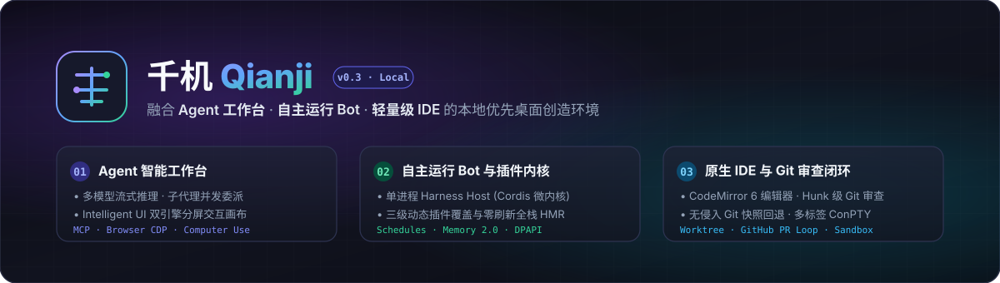
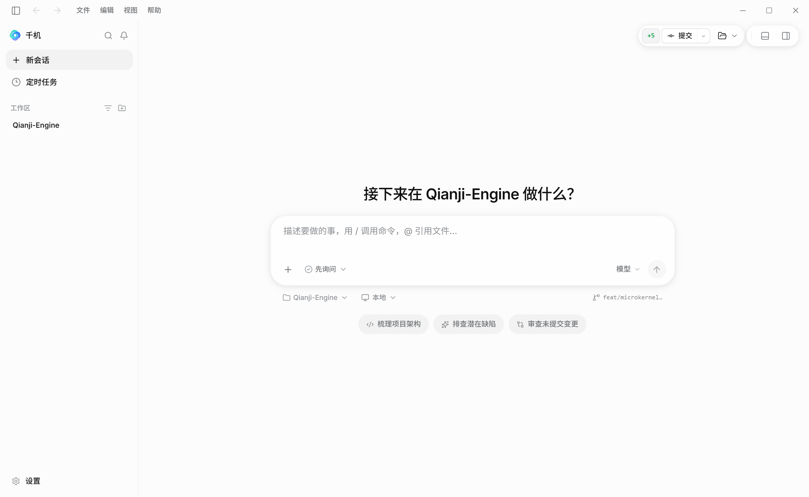
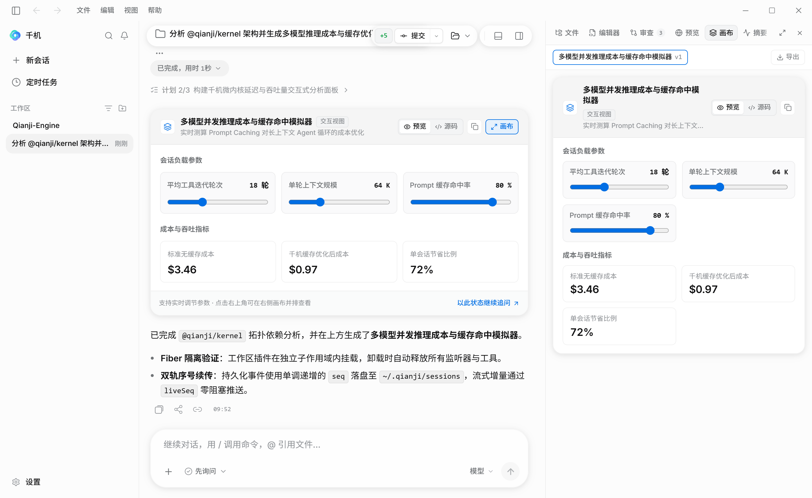
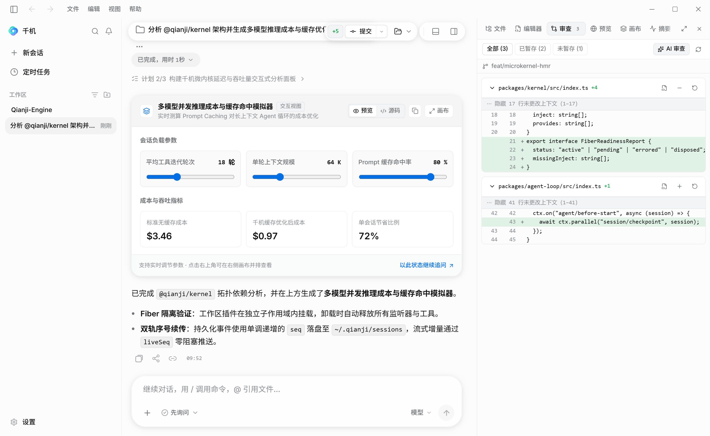
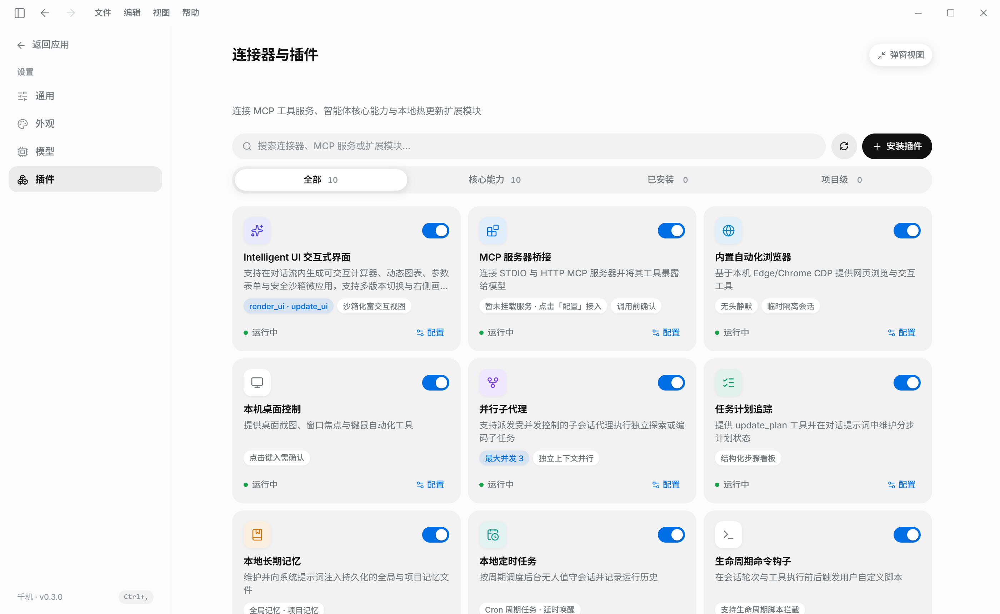
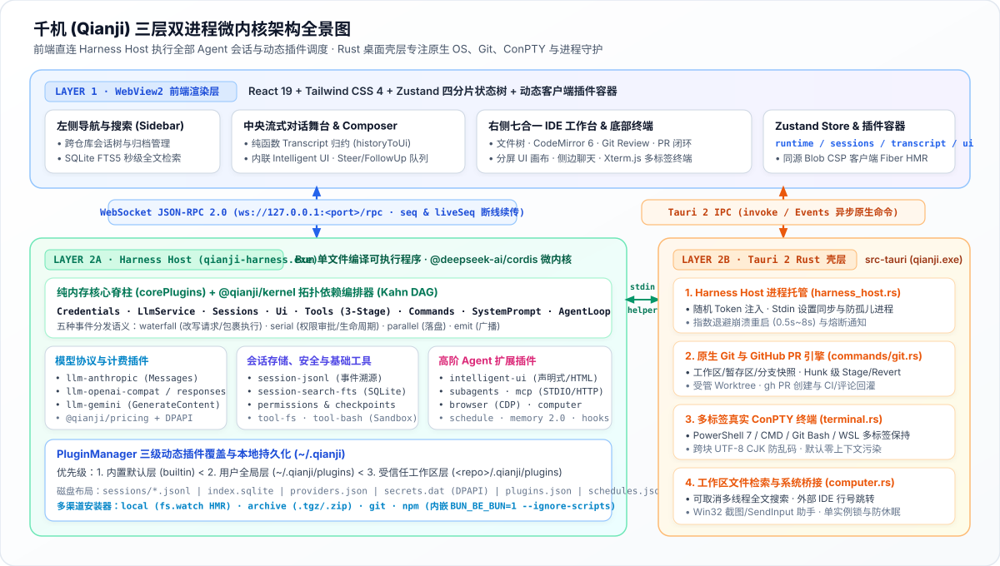

# Qianji (千机)



**A local-first Windows desktop creation environment fusing an Agent Workbench, an Autonomous Bot, and a Lightweight IDE.**

[**简体中文**](README.md) · [**English**](README.en.md)

[](LICENSE)
[](#quick-start)
[-6E56CF.svg)](docs/SYSTEM_DESIGN.md)
[](#system-architecture)

[Screenshots](#screenshots) · [Why Qianji?](#why-qianji) · [Capabilities](#capabilities) · [System Architecture](#system-architecture) · [Monorepo Packages](#monorepo-packages) · [Quick Start](#quick-start) · [Security Model](#security-model) · [Documentation](#documentation)

---

**Qianji (千机)** (formerly *Pi Desktop* before v0.3) is a **100% local-only** desktop environment engineered around its own microkernel engine, the **Harness Host** (`qianji-harness.exe`). One host process serves every concurrent task, subagent, and background schedule, wiring the agent loop, model adapters, tools, permissions, sessions, MCP, browser automation, computer use, and **Intelligent UI** as hot-reloadable [Cordis](https://github.com/cordiverse/cordis) plugins.

Qianji has **zero runtime dependency on external CLI agents or global Node.js installations** and **no cloud account or telemetry lock-in**. Existing `~/.pid` data and `%APPDATA%/pid-desktop` settings are migrated automatically to `~/.qianji` and `%APPDATA%/qianji` on first launch.

> [!NOTE]
> Qianji is an independent open-source project. It is not affiliated with or endorsed by OpenAI, Anthropic, or Google. References to Codex, Claude Artifacts, or Grok describe interaction patterns, not product ownership.

---

## Screenshots

| New Session Home & Composer | Intelligent UI & Split-Pane Canvas |
| :---: | :---: |
| <br/><sub>Workspace & Local/Worktree selector, model/thinking picker, and quick starters</sub> | <br/><sub>Live interactive calculators, charts, and sandboxed apps inline and side-by-side</sub> |
| **Unified Right IDE Workbench & Git Review** | **Connectors & Dynamic Plugin Center** |
| <br/><sub>Workspace files, CodeMirror 6 editor, hunk-level Git stage/revert, and side chat</sub> | <br/><sub>Manage MCP servers, CDP browser, desktop control, subagents, and hot-reloadable plugins</sub> |

---

## Why Qianji?

| Dimension | Typical CLI / Cloud Agents | Qianji (千机) |
| :--- | :--- | :--- |
| **Execution Architecture** | Spawns a separate runtime process per task or routes code through remote cloud workers | **Single-Host Microkernel**: One compiled `qianji-harness.exe` hosts all concurrent sessions, subagents, and schedules in isolated Cordis fibers ([ADR 0001](docs/adr/0001-harness-host-process.md)) |
| **Workspace Form Factor** | Terminal-only TUI or chat-only sidebar extension | **3-in-1 Native Workbench**: Unifies multi-turn Agent chat, a split-pane IDE (`Files` / `CodeMirror 6` / `Git Review` / `Preview` / `Intelligent UI Canvas` / `Side Chat`), and a multi-tab ConPTY terminal |
| **Data & Secret Sovereignty** | Cloud-stored transcripts or plaintext API keys in config files | **100% Local & DPAPI-Encrypted**: Append-only JSONL session logs (`~/.qianji/sessions`), offline SQLite FTS5 search (`~/.qianji/index.sqlite`), and Windows DPAPI secret storage (`secrets.dat`) |
| **Extensibility** | Static build-time tools or prompt-only skills | **Full-Stack Dynamic Plugins with HMR**: 3-tier override (`builtin` < `user` < `workspace`) with zero-reload TypeScript/TSX hot replacement across both Host and UI ([ADR 0016](docs/adr/0016-dynamic-plugins-and-hmr.md)) |
| **Workspace Safety** | All-or-nothing file mutations | **Turn Checkpoints & Approval Gates**: Non-invasive Git snapshots (`refs/qianji/checkpoints`) before every writable turn, unified diff review, and lightweight Windows Job Object sandboxing |

---

## Capabilities

### 1. Multi-Model Agent Core & Session Engine
- **Native Multi-Provider Streaming**: First-class adapters for **Anthropic Messages** (`/v1/messages` with thinking budgets & prompt caching), **OpenAI Chat Completions** (`/v1/chat/completions` compatible with DeepSeek, OpenRouter, Ollama, vLLM), **OpenAI Responses** (`/v1/responses` for o-series / GPT-5 reasoning), and **Google Gemini** (`streamGenerateContent`) ([ADR 0007](docs/adr/0007-llm-layer.md)).
- **Modes & Live Steering**: Switch dynamically between `Execute` (`agent`), `Plan`, and `Ask` modes; inject live `steer` corrections mid-run or curate an editable `followUp` queue; track step-by-step execution plans (`update_plan`).
- **In-Process Subagents**: Delegate parallel exploration or bounded coding subtasks via `delegate_task` (`@qianji/subagents`) running in child session fibers with restricted toolsets (no recursive delegation or arbitrary shell execution) ([ADR 0010](docs/adr/0010-subagents-mcp-usage.md)).
- **Event-Sourced Sessions & FTS5 Search**: Append-only JSONL logs with deterministic branch derivation, non-destructive `rewind` and `compaction`, session `fork`/`clone`, Markdown export, and asynchronous bilingual SQLite FTS5 full-text search ([ADR 0004](docs/adr/0004-session-format.md)).
- **Offline Cost & Token Observability**: Tracks input, output, cache read/write, and `reasoningTokens` per turn, estimating session and cumulative USD cost locally via `@qianji/pricing`.

### 2. Intelligent UI & Split-Pane Canvas
- **Generative Interactive Widgets (`@qianji/intelligent-ui`)**: Models can invoke `render_ui` and `update_ui` (or users can trigger `/ui <request>`) to compose live interactive artifacts inline in the chat stream and expand them in a Claude Artifacts-style split-pane canvas.
- **Dual Rendering Engines**:
  - **Declarative Engine (`declarative`)**: Zero-JS schema for sliders, numeric/select/toggle controls, real-time `Math.*` formula metric cards, bar/line/area/donut charts, searchable tables, tabs, checklists, and prompt-submitting forms.
  - **Isolated Sandbox Engine (`html`)**: Self-contained HTML/CSS/SVG/Canvas mini-apps served from an isolated loopback origin with strict CSP, theme token injection (`--pi-*`), version history switching, and `window.piUI.sendPrompt()` callback bridging.

### 3. Browser Control, Computer Use & MCP Ecosystem
- **Grok-Style Browser Automation (`@qianji/browser`)**: Drives local Edge, Chrome, or Chromium over CDP (`browser_navigate`, `browser_inspect`, `browser_click`, `browser_type`, `browser_screenshot`, …) with numbered inspect element refs, per-session browser isolation, workspace-scoped downloads, and idle auto-reclaiming ([ADR 0012](docs/adr/0012-browser.md)).
- **Windows Computer Use (`@qianji/computer`)**: Native Win32 screen/window observation and SendInput mouse/keyboard automation (`computer_sources`, `computer_start`, `computer_screenshot`, `computer_click`, `computer_type`, …) with per-session observe/control isolation and approval gates ([ADR 0011](docs/adr/0011-computer-and-schedule.md)).
- **Full MCP Host (`@qianji/mcp`)**: Connects to local newline-framed **STDIO** and remote **Streamable HTTP** MCP servers in the background; exposes dynamic `mcp__<server>__<tool>` tools with `list_changed` hot-refresh, exponential-backoff reconnect, live resource subscriptions (`/mcp-resources`, `/mcp-read`), prompt templates (`/mcp-prompts`), and DPAPI-encrypted secret headers/env.

### 4. Integrated IDE, Git Review & Worktree Workflow
- **Unified Right Workbench**: Docked, state-preserving tabs for **Workspace Files** (tree + streaming full-text search), **Code Editor** (CodeMirror 6 with syntax highlighting and `Ctrl+S`), **Review Diff**, **Browser Preview** (with one-click Agent visual verification), **Intelligent UI Canvas**, **Task Summary**, and **Side Chat** (temporary forked conversations from the latest settled checkpoint).
- **Codex-Style Git Review & PR Loop**: Inspect uncommitted, staged, unstaged, last-turn checkpoint, branch comparison, or commit diffs; stage, unstage, or revert individual diff hunks; collect inline review comments to send to the Agent in batch; draft commit messages and create/inspect GitHub Pull Requests via local `gh` CLI with one-click CI failure / review comment autofix.
- **Non-Invasive Checkpoints & Smart Rewind**: Automatically captures Git workspace snapshots under `refs/qianji/checkpoints` before writable turns without touching your real `.git/index`, enabling atomic rewind of both conversation history and workspace files ([ADR 0009](docs/adr/0009-feature-plugins.md)).
- **Managed Git Worktrees & Multi-Tab ConPTY Terminal**: Start tasks in isolated Git worktrees; run persistent multi-tab shells (PowerShell 7, Windows PowerShell, CMD, Git Bash, WSL) in the bottom panel (`Ctrl+J`). Terminal output is **never** injected into model context unless you explicitly click "Send to Chat".

### 5. Autonomous Bot, Memory 2.0 & Full-Stack Plugins
- **Local Scheduled Tasks (`@qianji/schedule`)**: Run recurring `hourly`, `daily`, `weekdays`, or `weekly` tasks in unattended sessions (`read-only`, `ask`, or `workspace-write` — silent `full-access` is prohibited) with run history and direct links to generated sessions ([ADR 0011](docs/adr/0011-computer-and-schedule.md)).
- **Dual-Layer Memory 2.0 (`@qianji/memory`) & Skills (`SKILL.md`)**: Separate toggles and editors for global (`~/.qianji/memory.md`) and workspace-trusted project memory (`<workspace>/.qianji/memory.md`) with unified diff approval gates before any agent write; built-in Skills Manager (`~/.qianji/skills`, `.qianji/skills`, `.agents/skills`) with live `/skill:<name>` slash command registration.
- **3-Tier Dynamic Plugins (`PluginManager`)**: Install plugins from local folders (with live file-watch HMR), `.tgz`/`.zip` archives, Git repositories, or npm (via the embedded Bun package manager with `--ignore-scripts`) ([ADR 0016](docs/adr/0016-dynamic-plugins-and-hmr.md)).

---

## System Architecture

> For the comprehensive architectural specification, sequence diagrams, data storage layout, and subsystem internals, see **[docs/SYSTEM_DESIGN.md](docs/SYSTEM_DESIGN.md)** and the **[Architecture Decision Records (docs/adr)](docs/adr/README.md)**.



- **The Rust Shell (`src-tauri`)** owns the application window, system tray, prevent-sleep thread, native Git diff/stage/PR commands, ConPTY terminal sessions, workspace file streaming search, the `--computer-helper` native bridge, and the lifecycle of the Harness Host child process. It passes desktop settings to the Host over `stdin` and automatically restarts the Host with exponential backoff if it crashes ([ADR 0001](docs/adr/0001-harness-host-process.md), [ADR 0013](docs/adr/0013-desktop-settings-and-secrets.md)).
- **The Harness Host (`packages/host`)** is compiled into a standalone Windows executable (`qianji-harness.exe`) using `esbuild` and `bun build --compile`, so end users need no external runtime. The frontend talks directly to the Host over authenticated loopback WebSocket JSON-RPC 2.0 for all agent, session, model, MCP, schedule, and plugin operations ([ADR 0002](docs/adr/0002-client-protocol.md), [ADR 0014](docs/adr/0014-frontend-harness-adapter.md)).

---

## Monorepo Packages

The repository is organized as an npm workspace (`packages/*`) with strict architectural import boundaries enforced by ESLint ([ADR 0005](docs/adr/0005-repository-layout.md)):

| Package | Role | Description |
| :--- | :--- | :--- |
| `packages/protocol` | Shared Contract | JSON-RPC 2.0 wire types, method schemas, error codes, and secret redaction shared by UI and Host |
| `packages/kernel` | Microkernel | Cordis dependency extraction, deterministic Kahn topological sort, fiber readiness inspection, and workspace scopes |
| `packages/host` | Engine Entry | Process entrypoint, WebServer, PluginManager, client TSX bundler, DPAPI FFI secret store, and RPC services |
| `packages/agent` & `packages/agent-loop` | Agent Core | Agent service contracts, streaming delta types, and the single deterministic multi-turn Agent Loop |
| `packages/llm` & `packages/llm-*` | Model Layer | Unified streaming LLM interface, credential refs, and native adapters for OpenAI Compat, OpenAI Responses, Anthropic, and Gemini |
| `packages/pricing` | Observability | Offline model pricing catalog and per-turn / cumulative USD cost estimation |
| `packages/session`, `session-jsonl`, `session-search-fts` | Storage & Search | Event-sourced session state, branch derivation, append-only JSONL persistence, and SQLite FTS5 indexing |
| `packages/tools`, `tool-fs`, `tool-bash` | Tooling & Sandbox | Three-stage tool execution pipeline (`pre-execute` → `execute` → `result`), filesystem tools, and sandboxed Git Bash execution |
| `packages/permissions` & `packages/checkpoints` | Safety & Rewind | Ordered allow/confirm/block rule engine, permission modes, and non-invasive Git snapshot creation/restore |
| `packages/system-prompt` & `packages/prompt-context` | Context Builder | Ordered system prompt assembly, `AGENTS.md`/`CLAUDE.md` discovery, and `SKILL.md` lifecycle management |
| `packages/plan`, `memory`, `hooks`, `commands`, `ui` | Capabilities | Step plan tracking, dual-layer Memory 2.0 with diff approval, lifecycle shell hooks, slash commands, and UI request bus |
| `packages/subagents`, `mcp`, `browser`, `computer`, `schedule`, `intelligent-ui` | Extensions | In-process subagents, STDIO/HTTP MCP client, CDP browser driver, Windows computer use, cron-like scheduler, and generative UI |
| `src/` & `src-tauri/` | Desktop Client | React 19 + Zustand 4-slice frontend workbench (`src/`) and Tauri 2 Rust native shell (`src-tauri/`) |

---

## Quick Start

### Prerequisites
- **Windows 10 / 11 (x64)** with **WebView2** (pre-installed on modern Windows)
- **Node.js >= 22** and `npm`
- **Rust stable** with the `x86_64-pc-windows-msvc` toolchain

### Development & Desktop Build

`npm ci` installs workspace dependencies and the pinned Bun compiler. Tauri dev and build commands compile `qianji-harness.exe` automatically via [`scripts/prepare-harness-host.mjs`](scripts/prepare-harness-host.mjs).

```powershell
# 1. Install dependencies
npm ci

# 2. Launch the desktop app in development mode (auto-builds Harness Host)
npm run tauri -- dev

# 3. Build production Windows installers (NSIS / MSI)
npm run tauri -- build
```

### Headless CLI Mode

The compiled Harness Host also supports standalone headless execution for scripting and CI workflows:

```powershell
npm run prepare:harness-host
.\src-tauri\resources\harness\qianji-harness.exe run --cwd . --model anthropic/claude-sonnet-4-20250514 "Summarize the repository architecture"
```

### Quality & Verification Gates

Every pull request must pass all 7 verification gates:

```powershell
npm run scan:secrets            # Scan working tree and Git history for leaked credentials
npm audit --audit-level=high    # Verify npm dependency security baseline
npm run typecheck               # Type-check UI, build scripts, packages/*, and E2E suites
npm run lint                    # Enforce code quality and ADR 0005 module boundary rules
npm run test:unit               # Run Vitest unit/golden tests, exe smoke tests, hygiene & doc-link checks
npm run test:stress             # Run Host concurrency, high-frequency delta, and HMR memory leak stress tests
npm run test:e2e                # Run Playwright E2E tests in Edge against a real Harness Host

# Run Rust unit tests
Push-Location src-tauri
cargo test
Pop-Location
```

---

## Security Model

1. **Permission Modes & Lightweight Sandbox**:
   - `read-only`, `ask`, `workspace-write`, and `full-access` modes are enforced by `@qianji/permissions` on `tools/pre-execute` before any model-initiated tool runs.
   - In non-`full-access` modes, `@qianji/tool-bash` applies a lightweight Windows sandbox (credential environment scrubbing, `.qianji/sandbox-tmp` redirection, static high-risk command blocking, and Windows Job Object process limits).
   - Approval gates and process-level guards are **not** a kernel or hypervisor virtualization boundary. For untrusted or unattended workloads, export a `.wsb` (Windows Sandbox) or `.devcontainer` configuration directly from Settings (`sandbox.generateConfig`).
2. **Encrypted Credentials at Rest (Windows DPAPI)**:
   - Model provider API keys (`~/.qianji/secrets.dat`) and MCP server secrets (`%APPDATA%/qianji/mcp-secrets.dat`) are encrypted on disk using Windows `CryptProtectData` (DPAPI) bound to the current OS user. Configuration files store only opaque `SecretRef` pointers or `$ENV_VAR` names ([ADR 0013](docs/adr/0013-desktop-settings-and-secrets.md)).
3. **Workspace Trust Gate**:
   - Project-scoped plugins (`<workspace>/.qianji/plugins`), project configurations (`<workspace>/.qianji/harness.json`), and project memory are **never** loaded until the user explicitly grants trust to the canonical workspace path in `~/.qianji/trusted-workspaces.json`. Revoking trust immediately disposes the workspace's isolated Cordis fiber ([ADR 0016](docs/adr/0016-dynamic-plugins-and-hmr.md)).
4. **Browser, Computer Use & Scheduled Tasks**:
   - Observation tools (`computer_sources`, `computer_screenshot`, `computer_inspect`) are read-only; interactive input requires `computer_start` in control mode and an approval gate. Windows UIPI still prevents input into higher-integrity windows.
   - Scheduled tasks execute only while the computer and Qianji are running, mark their sessions as unattended (auto-denying any confirmation prompt), and prohibit `full-access` mode.

Report security vulnerabilities privately as described in [SECURITY.md](SECURITY.md).

---

## Documentation

- **[System Design Document (`docs/SYSTEM_DESIGN.md`)](docs/SYSTEM_DESIGN.md)** — Complete architecture, sequence diagrams, subsystem breakdown, state management, and data directory specification.
- **[Architecture Decision Records (`docs/adr/README.md`)](docs/adr/README.md)** — ADR 0001 through ADR 0016 covering the V2 Harness Host architecture.
- **[Local Capabilities Boundary (`docs/LOCAL_CAPABILITIES.md`)](docs/LOCAL_CAPABILITIES.md)** — Scope baseline, completed local capabilities, and explicit non-goals.
- **[Codex UI Reference (`docs/CODEX_UI_REFERENCE.md`)](docs/CODEX_UI_REFERENCE.md)** — Design restraint and interaction references for the workbench, composer, and diff review UI.
- **[Appearance Extensions (`docs/appearance-extensions.md`)](docs/appearance-extensions.md)** — Custom themes and appearance package format.
- **[Dependency Security Baseline (`docs/DEPENDENCY_SECURITY.md`)](docs/DEPENDENCY_SECURITY.md)** — RustSec and npm audit baseline and license inventory.
- **[Release Checklist (`docs/RELEASING.md`)](docs/RELEASING.md)** & **[Contributing Guide (`CONTRIBUTING.md`)](CONTRIBUTING.md)**.

---

## License

Qianji is licensed under the [Apache License 2.0](LICENSE). See [THIRD_PARTY_NOTICES.md](THIRD_PARTY_NOTICES.md) for bundled third-party software notices.
