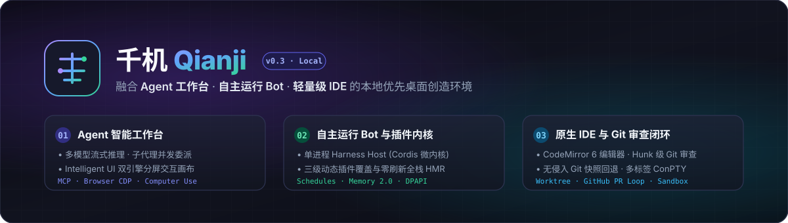
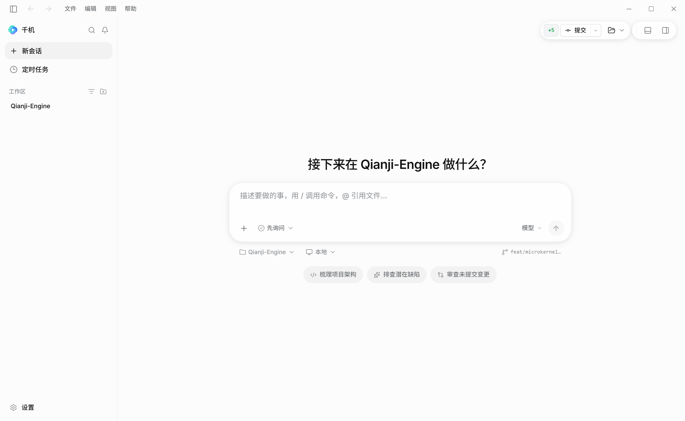
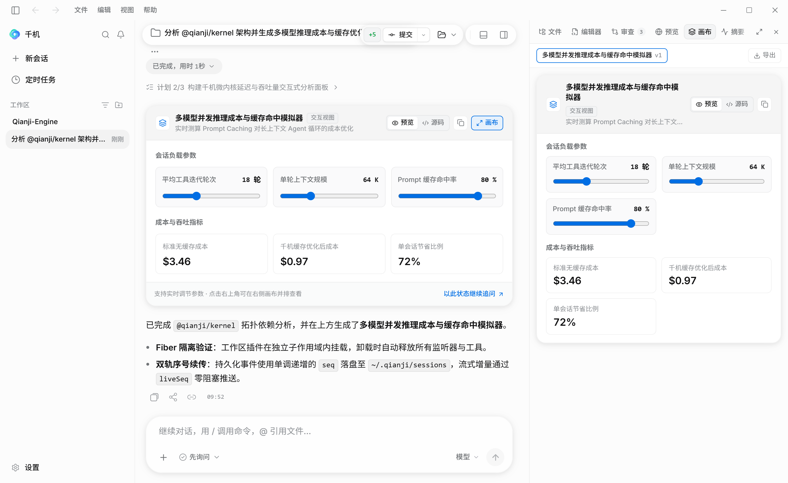
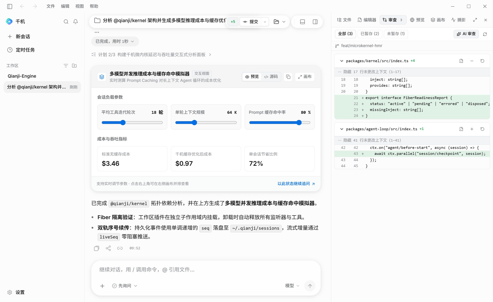
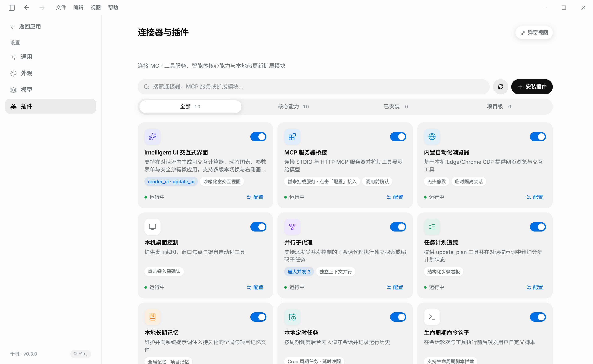
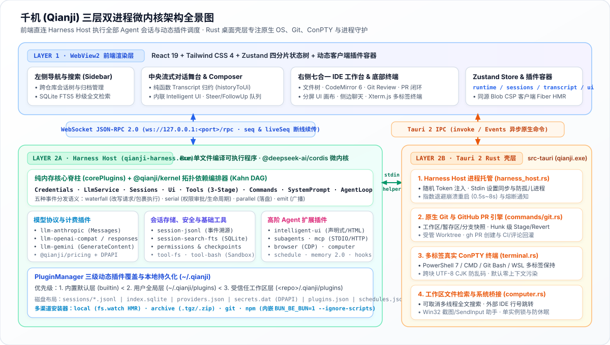

# 千机 (Qianji)



**融合 Agent 工作台、自主运行 Bot 与轻量级 IDE 的本地优先（Local-First）Windows 桌面创造环境。**

[**简体中文**](README.md) · [**English**](README.en.md)

[](LICENSE)
[](#快速开始)
[-6E56CF.svg)](docs/SYSTEM_DESIGN.md)
[](#系统架构)

[界面预览](#界面预览) · [为什么选择千机？](#为什么选择千机) · [核心能力](#核心能力) · [系统架构](#系统架构) · [Monorepo 模块矩阵](#monorepo-模块矩阵) · [快速开始](#快速开始) · [安全与隐私模型](#安全与隐私模型) · [文档导航](#文档导航)

---

**千机（Qianji）**（v0.3 之前原名 *Pi Desktop*）是一款 **100% 本地运行** 的桌面级 AI 创造环境，其核心引擎是基于微内核架构自研的 **Harness Host**（`qianji-harness.exe`）。单个宿主进程即可承载所有并发工作区会话、子代理与后台定时任务，将 Agent 状态机循环、模型协议适配、工具管线、权限策略、会话存储、MCP 桥接、浏览器控制、桌面键鼠自动化（Computer Use）以及生成式交互界面（**Intelligent UI**）全部组织为可热重载的 [Cordis](https://github.com/cordiverse/cordis) 插件。

千机 **零外部 CLI 运行时依赖（无需用户预装 Node.js 或 Bun）**，**无云端账号绑定或遥测上传**。首次启动时，旧版 `~/.pid` 数据与 `%APPDATA%/pid-desktop` 设置会自动无损迁移至 `~/.qianji` 与 `%APPDATA%/qianji`。

> [!NOTE]
> 千机是独立的开源项目，与 OpenAI、Anthropic 或 Google 无隶属或背书关系。文档中提及的 Codex、Claude Artifacts 或 Grok 仅用于说明交互范式参考。

---

## 界面预览

| 新会话工作台首页 (Home & Composer) | Intelligent UI 交互组件与右侧分屏画布 |
| :---: | :---: |
| <br/><sub>支持本地/Worktree 环境切换、分组模型与推理等级选择、快捷启动卡片</sub> | <br/><sub>在对话流内实时生成可交互计算器/图表卡片，并在右侧画布并排展开</sub> |
| **右侧七合一原生 IDE 工作台与 Git 审查** | **连接器与全栈动态插件管理中心** |
| <br/><sub>内置文件树、CodeMirror 6、Hunk 级 Git Stage/Revert 审查与侧边聊天</sub> | <br/><sub>统一管理 MCP 服务桥接、CDP 自动化浏览器、桌面控制与热重载扩展模块</sub> |

---

## 为什么选择千机？

| 维度 | 传统 CLI / 云端 Agent 工具 | 千机 (Qianji) |
| :--- | :--- | :--- |
| **运行与调度架构** | 每个任务启动独立进程，或将代码上传至远程云端容器执行 | **单进程微内核宿主**：单个单文件 `qianji-harness.exe` 在隔离的 Cordis Fiber 作用域内并发承载所有会话、子代理与定时任务（[ADR 0001](docs/adr/0001-harness-host-process.md)） |
| **工作台交互形态** | 纯终端 TUI 界面，或依附于编辑器的窄侧边栏对话插件 | **三合一原生工作台**：集流式多轮对话、分屏 IDE 工作台（`文件树` / `CodeMirror 6 编辑器` / `Git 审查` / `Web 预览` / `Intelligent UI 画布` / `侧边聊天`）与多标签 ConPTY 终端于一体 |
| **数据与凭据主权** | 会话记录保存在云端，或将 API Key 明文写入本地配置文件 | **100% 本地存储 + DPAPI 硬件级加密**：追加写 JSONL 会话日志（`~/.qianji/sessions`）、离线 SQLite FTS5 双语检索（`~/.qianji/index.sqlite`）及 Windows DPAPI 密钥存储（`secrets.dat`） |
| **全栈可扩展性** | 编译期静态固化的内置工具，或仅支持纯文本提示词扩展 | **三级动态插件与零刷新 HMR**：支持 `builtin` < `user` < `workspace` 三层覆盖，前后端 TypeScript/TSX 修改毫秒级无感热替换（[ADR 0016](docs/adr/0016-dynamic-plugins-and-hmr.md)） |
| **工作区操作安全** | 全量覆写文件难以回退，或缺乏细粒度执行拦截 | **轮次快照与多层门禁**：每轮可写操作前自动建立无侵入 Git 快照（`refs/qianji/checkpoints`），配合工具审批门禁与 Windows Job Object 轻量进程沙箱 |

---

## 核心能力

### 1. 多模型 Agent 核心与会话引擎
- **四大原生流式协议适配**：原生支持 **Anthropic Messages**（`/v1/messages`，含思考预算与 Prompt Caching）、**OpenAI Chat Completions**（`/v1/chat/completions`，兼容 DeepSeek、OpenRouter、Ollama、vLLM 等）、**OpenAI Responses**（`/v1/responses`，适配 o 系列与 GPT-5 深度推理）以及 **Google Gemini**（`streamGenerateContent`）（[ADR 0007](docs/adr/0007-llm-layer.md)）。
- **多协作模式与实时干预**：支持在会话中随时切换 `Execute`（执行）、`Plan`（规划）与 `Ask`（问答）模式；运行中途可随时注入 `steer` 纠偏指令，或编辑重排 `followUp` 待办队列；内置 `update_plan` 分步计划追踪。
- **进程内受限子代理（`@qianji/subagents`）**：通过 `delegate_task` 在同一宿主进程内派生并行子会话执行代码探索或独立子任务，自动剥离 `bash` 与递归委派权限，支持父会话一键联动中止（[ADR 0010](docs/adr/0010-subagents-mcp-usage.md)）。
- **事件溯源会话与 FTS5 全文搜索**：基于单调递增 `seq` 的追加写 JSONL 日志，确定性派生分支上下文；支持非破坏性消息回退（`rewind`）、上下文压缩（`compaction`）、会话分叉（`fork`/`clone`）、Markdown 导出以及异步构建的 SQLite FTS5 中英双语全文检索（[ADR 0004](docs/adr/0004-session-format.md)）。
- **离线 Token 与成本可观测性**：精确采集输入、输出、缓存命中及 `reasoningTokens`，通过 `@qianji/pricing` 本地费率表实时估算单次会话与全局累计美元开销。

### 2. Intelligent UI 与分屏交互画布
- **生成式交互组件（`@qianji/intelligent-ui`）**：模型可主动调用 `render_ui` / `update_ui`（或由用户输入 `/ui <需求描述>` 触发），在对话流中直接生成可交互微应用卡片，并支持在右侧分屏画布（Split-Pane Canvas）中展开检视。
- **双渲染引擎驱动**：
  - **原生声明式引擎 (`declarative`)**：零 JS 脚本配置滑块、数值、下拉、开关控制器，支持 `Math.*` 实时公式计算指标卡、柱状/折线/面积/环形图表、可搜索数据表、多标签页、核对清单以及一键回填对话的动态表单。
  - **受控沙箱引擎 (`html`)**：通过受控回环沙箱端口与严格 CSP 运行自包含的 HTML/CSS/SVG/Canvas 微应用，自动注入 `--pi-*` 主题色彩变量，支持多版本历史切换与 `window.piUI.sendPrompt()` 双向交互桥接。

### 3. 浏览器控制、Computer Use 与 MCP 生态
- **Grok 风格浏览器自动化（`@qianji/browser`）**：基于本机 Edge、Chrome 或 Chromium 的 CDP 协议提供 `browser_navigate`、`browser_inspect`、`browser_click`、`browser_type`、`browser_screenshot` 等工具，支持页面元素编号引用、**按 Agent 会话隔离浏览器实例**、工作区内受限上传下载与空闲自动回收（[ADR 0012](docs/adr/0012-browser.md)）。
- **Windows 原生桌面控制（`@qianji/computer`）**：提供 `computer_sources`、`computer_start`、`computer_screenshot`、`computer_click`、`computer_type` 等桌面视觉与键鼠工具，按会话隔离观察（`observe`）与控制（`control`）状态，交互输入受独立审批门禁保护（[ADR 0011](docs/adr/0011-computer-and-schedule.md)）。
- **完整 MCP 宿主（`@qianji/mcp`）**：后台非阻塞连接本地换行帧 **STDIO** 与远程 **Streamable HTTP** MCP 服务器；自动将发现的工具注册为 `mcp__<server>__<tool>`，支持 `list_changed` 热刷新、指数退避重连、Resources 列表/读取/订阅（`/mcp-resources`、`/mcp-read`）、Prompts 模板解析（`/mcp-prompts`）以及 DPAPI 加密凭据注入。

### 4. 集成 IDE、Git 代码审查与 Worktree 工作流
- **统一右侧工作台（Right Workbench）**：常驻且保持状态的 7 大功能面板——**工作区文件**（目录树与流式全文检索）、**代码编辑器**（CodeMirror 6 多语言高亮与 `Ctrl+S` 保存）、**代码审查（Review）**、**内置浏览器预览**（支持一键请 Agent 视觉验证页面）、**Intelligent UI 画布**、**任务摘要**以及**侧边聊天（Side Chat）**（从当前会话最新稳定点一键分叉的临时追问窗口）。
- **Codex 风格 Git Review 与 PR 闭环**：支持查看未提交、已暂存、未暂存、上一轮快照（Turn Checkpoint）、分支对比与历史提交 Diff；支持 Hunk 级暂存、取消暂存与丢弃；支持在代码行添加评论并批量发送给 Agent 修改；集成 `gh` CLI 实现桌面端一键生成并创建 Pull Request，以及将 PR 审查意见与 CI 失败日志一键回灌对话自动修复。
- **无侵入 Git 快照与消息回退**：每轮可写操作前自动在私有引用 `refs/qianji/checkpoints` 下创建工作区快照（绝不污染真实的 `.git/index`），支持消息与工作区文件一键原子回退（[ADR 0009](docs/adr/0009-feature-plugins.md)）。
- **受管 Git Worktree 与多标签真实终端**：支持在独立 Git Worktree 中开启新任务；底部集成多标签 ConPTY 终端（`Ctrl+J`，支持 PowerShell 7、Windows PowerShell、CMD、Git Bash、WSL）。**终端输出默认绝不自动塞入模型上下文**，仅在用户主动点击“发送到对话”时按需引用。

### 5. 自主运行 Bot、双层长期记忆与动态插件
- **本地无人值守定时任务（`@qianji/schedule`）**：支持按 `hourly`、`daily`、`weekdays`、`weekly` 周期调度本地任务，强制运行于无人值守安全权限模式（`read-only`、`ask` 或 `workspace-write`，严禁静默 `full-access`），完整保留运行历史与结果会话链接（[ADR 0011](docs/adr/0011-computer-and-schedule.md)）。
- **双层长期记忆 2.0（`@qianji/memory`）与技能中心（`SKILL.md`）**：全局记忆（`~/.qianji/memory.md`）与项目记忆（`<workspace>/.qianji/memory.md`）独立开关与编辑，Agent 写入记忆前强制弹出 Unified Diff 审批；内置技能中心管理 `~/.qianji/skills`、`.qianji/skills` 与 `.agents/skills`，实时同步 `/skill:<name>` 斜杠指令。
- **三级全栈动态插件（`PluginManager`）**：支持从本地目录（开启文件监听 HMR）、离线归档包（`.tgz`/`.zip`）、Git 仓库或 npm（复用内嵌 Bun 包管理器执行 `--ignore-scripts` 安全安装）安装与更新插件（[ADR 0016](docs/adr/0016-dynamic-plugins-and-hmr.md)）。

---

## 系统架构

> 完整的系统架构设计、序列图、状态树设计与数据落盘规范请参阅 **[系统设计文档 (`docs/SYSTEM_DESIGN.md`)](docs/SYSTEM_DESIGN.md)** 与 **[架构决策记录 (`docs/adr`)](docs/adr/README.md)**。



- **Rust 桌面壳层（`src-tauri`）**：负责主窗口与系统托盘、防休眠后台线程、原生 Git 状态/Hunk 暂存/PR 命令、ConPTY 终端会话、工作区文件流式检索、`--computer-helper` 原生桥接以及 Harness Host 进程托管。Rust 通过 `stdin` 向 Host 下发配置，并在 Host 异常退出时按指数退避策略自动拉起恢复（[ADR 0001](docs/adr/0001-harness-host-process.md)、[ADR 0013](docs/adr/0013-desktop-settings-and-secrets.md)）。
- **Harness Host 引擎（`packages/host`）**：通过 `esbuild` 与 `bun build --compile` 编译为独立单文件可执行程序 `qianji-harness.exe`，终端用户无需安装 Node.js。前端通过本地回环 WebSocket 上的 JSON-RPC 2.0 协议直连 Host 完成所有 Agent、会话、模型、MCP、定时任务与插件操作（[ADR 0002](docs/adr/0002-client-protocol.md)、[ADR 0014](docs/adr/0014-frontend-harness-adapter.md)）。

---

## Monorepo 模块矩阵

仓库采用 npm workspaces（`packages/*`）组织，并由 ESLint 强制守护模块依赖边界（[ADR 0005](docs/adr/0005-repository-layout.md)）：

| 模块路径 | 角色定位 | 职责说明 |
| :--- | :--- | :--- |
| `packages/protocol` | 共享协议契约 | 前端与 Host 共用的 JSON-RPC 2.0 消息类型、方法签名、错误码与敏感字段脱敏规则 |
| `packages/kernel` | 微内核编排器 | Cordis 依赖元数据提取、确定性 Kahn 拓扑排序、Fiber 就绪状态探针与工作区隔离作用域 |
| `packages/host` | 宿主进程入口 | 进程启动、WebServer、PluginManager、客户端 TSX 实时打包器、DPAPI FFI 密钥库与 RPC 路由 |
| `packages/agent` & `packages/agent-loop` | Agent 核心 | Agent 服务契约、流式增量类型以及全局唯一的确定性多轮推理循环 |
| `packages/llm` & `packages/llm-*` | 模型适配层 | 统一流式 LLM 接口、凭据引用抽象，以及 OpenAI Compat、OpenAI Responses、Anthropic、Gemini 适配器 |
| `packages/pricing` | 成本可观测性 | 离线模型单价目录及单次调用 / 会话累计美元成本估算 |
| `packages/session`, `session-jsonl`, `session-search-fts` | 会话与检索 | 事件溯源状态模型、分支派生算法、追加写 JSONL 存储后端与 SQLite FTS5 全文检索索引 |
| `packages/tools`, `tool-fs`, `tool-bash` | 工具与沙箱 | 三段式工具执行管线（`pre-execute` → `execute` → `result`）、文件读写检索工具与受沙箱保护的 Git Bash 执行器 |
| `packages/permissions` & `packages/checkpoints` | 权限与快照 | 有序 allow/confirm/block 规则引擎、权限模式管理与无侵入 Git 快照创建/还原 |
| `packages/system-prompt` & `packages/prompt-context` | 提示词组装 | 按序拼接系统提示词片段、`AGENTS.md`/`CLAUDE.md` 上下文发现与 `SKILL.md` 技能生命周期管理 |
| `packages/plan`, `memory`, `hooks`, `commands`, `ui` | 基础能力插件 | 分步计划追踪、带 Diff 审批的双层记忆 2.0、生命周期脚本钩子、斜杠命令总线与交互请求通道 |
| `packages/subagents`, `mcp`, `browser`, `computer`, `schedule`, `intelligent-ui` | 高阶扩展插件 | 进程内子代理、STDIO/HTTP MCP 客户端、CDP 浏览器驱动、Windows 桌面控制、定时调度器与生成式 UI |
| `src/` & `src-tauri/` | 桌面客户端 | React 19 + Zustand 四分片前端工作台（`src/`）与 Tauri 2 Rust 原生壳层（`src-tauri/`） |

---

## 快速开始

### 环境要求
- **Windows 10 / 11 (x64)** 且已安装 **WebView2**（现代 Windows 系统均已预装）
- **Node.js >= 22** 与 `npm`
- **Rust stable**（`x86_64-pc-windows-msvc` 工具链）

### 开发运行与安装包构建

执行 `npm ci` 会安装所有工作区依赖与锁定的 Bun 编译器。运行 Tauri 开发或构建命令时，会通过 [`scripts/prepare-harness-host.mjs`](scripts/prepare-harness-host.mjs) 自动编译生成 `qianji-harness.exe`。

```powershell
# 1. 安装依赖
npm ci

# 2. 启动桌面端开发模式（自动构建并托管 Harness Host）
npm run tauri -- dev

# 3. 构建生产环境 Windows 安装包（NSIS / MSI）
npm run tauri -- build
```

### Headless CLI 命令行模式

编译后的 Harness Host 支持脱离桌面界面独立运行，便于脚本调用与自动化集成：

```powershell
npm run prepare:harness-host
.\src-tauri\resources\harness\qianji-harness.exe run --cwd . --model anthropic/claude-sonnet-4-20250514 "梳理当前仓库的模块架构"
```

### 质量与安全验证门禁

每次提交与 PR 均需通过以下 7 道自动化质量检查：

```powershell
npm run scan:secrets            # 扫描工作区与 Git 历史中的潜在硬编码密钥
npm audit --audit-level=high    # 检查 npm 依赖安全漏洞基线
npm run typecheck               # 全量类型检查（前端 UI、构建脚本、packages/* 与 E2E）
npm run lint                    # 代码规范与 ADR 0005 模块依赖边界检查
npm run test:unit               # 运行 Vitest 单元/黄金日志测试、exe 冒烟测试、仓库卫生与文档链接检查
npm run test:stress             # 运行 Host 高并发会话、高频流式增量与 HMR 内存泄漏压力测试
npm run test:e2e                # 在本机 Edge 浏览器中运行连接真实 Harness Host 的 Playwright E2E 测试

# 运行 Rust 单元测试
Push-Location src-tauri
cargo test
Pop-Location
```

---

## 安全与隐私模型

1. **权限模式与 Windows 轻量沙箱**：
   - `@qianji/permissions` 在 `tools/pre-execute` 阶段严格执行 `read-only`、`ask`、`workspace-write` 与 `full-access` 四档权限策略。
   - 在非 `full-access` 模式下，`@qianji/tool-bash` 默认启用轻量级 Windows 进程沙箱（敏感环境变量脱敏、`.qianji/sandbox-tmp` 临时目录重定向、高危系统修改命令拦截与 Windows Job Object 进程数限制）。
   - 应用层审批门禁与进程级限制**不等同于**操作系统内核或虚拟化级隔离边界。处理不可信代码或无人值守任务时，可在“设置”中一键导出 `.wsb`（Windows Sandbox）或 `.devcontainer` 配置文件在强隔离容器中运行。
2. **静态凭据 DPAPI 加密**：
   - 模型提供商 API 密钥（`~/.qianji/secrets.dat`）与 MCP 服务器敏感凭据（`%APPDATA%/qianji/mcp-secrets.dat`）均调用 Windows 原生 `CryptProtectData`（DPAPI）按当前系统登录用户加密落盘，配置文件中仅保存不透明引用或 `$ENV_VAR` 环境变量名（[ADR 0013](docs/adr/0013-desktop-settings-and-secrets.md)）。
3. **工作区显式信任门禁**：
   - 项目级动态插件（`<workspace>/.qianji/plugins`）、项目级配置（`<workspace>/.qianji/harness.json`）与项目记忆必须经用户显式信任（记录于 `~/.qianji/trusted-workspaces.json`）后才会加载；撤销信任将立即卸载对应工作区的隔离 Fiber（[ADR 0016](docs/adr/0016-dynamic-plugins-and-hmr.md)）。
4. **桌面控制与本地定时任务边界**：
   - 桌面观察工具（`computer_sources`、`computer_screenshot`、`computer_inspect`）为只读操作；键鼠注入必须在 `control` 模式下启动并通过独立审批门禁，且遵循 Windows UIPI 完整性级别限制。
   - 定时任务仅在电脑与千机运行期间在本地触发，会话强制标记为无人值守状态（任何需弹窗确认的操作自动拒绝），且严禁使用 `full-access` 权限。

如发现安全漏洞，请按 [SECURITY.md](SECURITY.md) 中的说明私密报告。

---

## 文档导航

- **[完整系统设计文档 (`docs/SYSTEM_DESIGN.md`)](docs/SYSTEM_DESIGN.md)** — 涵盖总体架构、核心子系统序列图、微内核扩展点、前端状态架构与本地数据存储规范。
- **[架构决策记录 (`docs/adr/README.md`)](docs/adr/README.md)** — 记录 V2 Harness Host 重构全过程的 ADR 0001 至 ADR 0016。
- **[本地能力边界 (`docs/LOCAL_CAPABILITIES.md`)](docs/LOCAL_CAPABILITIES.md)** — 本地核心能力基线、持续演进方向与明确不做的范围边界。
- **[Codex UI 交互参考 (`docs/CODEX_UI_REFERENCE.md`)](docs/CODEX_UI_REFERENCE.md)** — 工作台、Composer 输入框与代码审查界面的视觉克制与交互规范。
- **[外观扩展规范 (`docs/appearance-extensions.md`)](docs/appearance-extensions.md)** — 自定义主题与外观扩展包格式说明。
- **[依赖安全基线 (`docs/DEPENDENCY_SECURITY.md`)](docs/DEPENDENCY_SECURITY.md)** — RustSec 与 npm 依赖审计基线及开源许可证盘点。
- **[发布检查清单 (`docs/RELEASING.md`)](docs/RELEASING.md)** 与 **[贡献指南 (`CONTRIBUTING.md`)](CONTRIBUTING.md)**。

---

## 开源许可

千机（Qianji）基于 [Apache License 2.0](LICENSE) 开源许可发布。随附第三方组件的版权与许可证声明请参阅 [THIRD_PARTY_NOTICES.md](THIRD_PARTY_NOTICES.md)。
