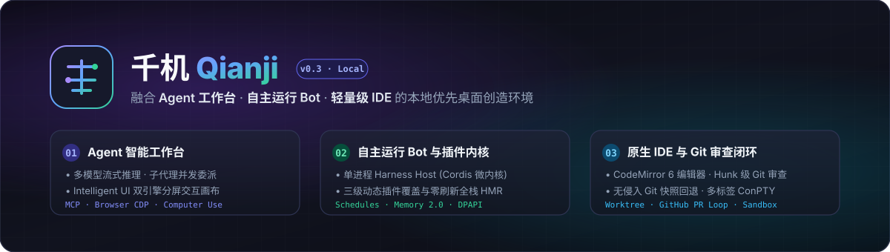
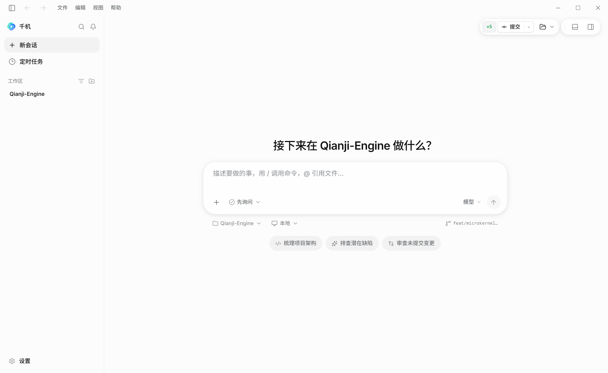
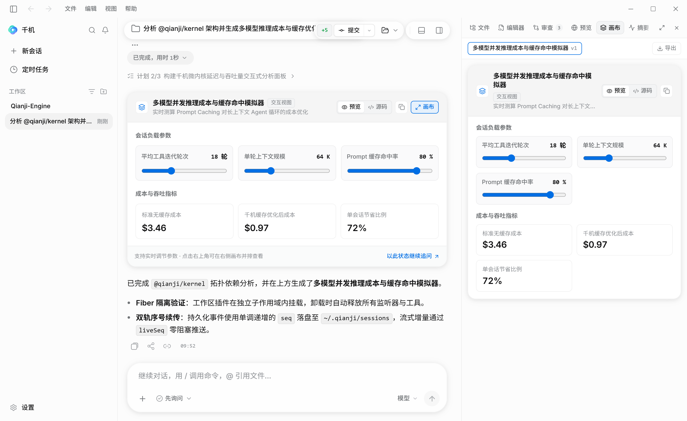
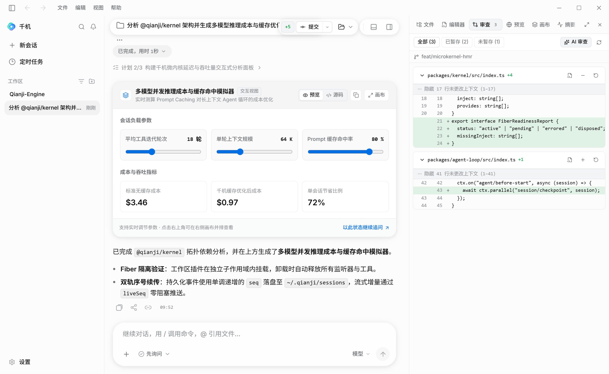
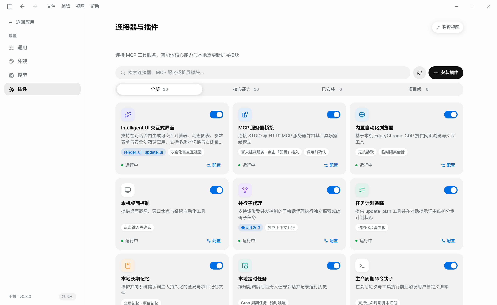
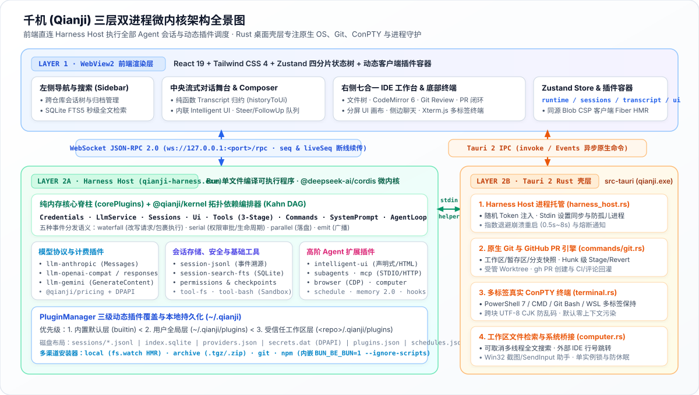
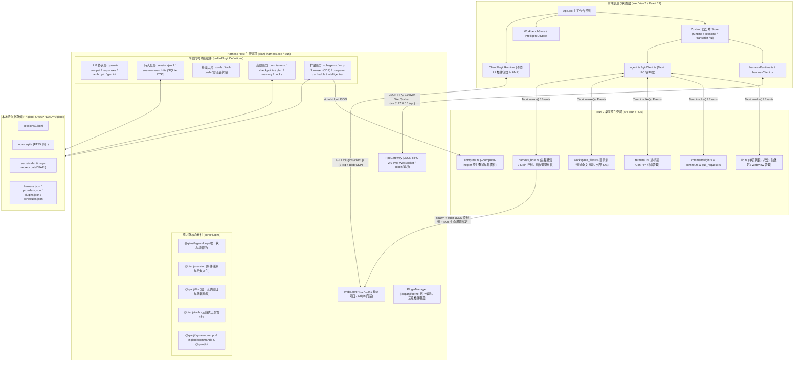
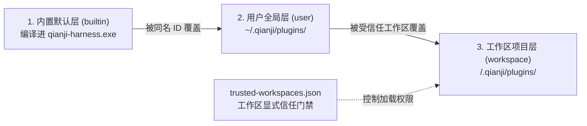

# 千机（Qianji / PI-Desktop）完整系统设计文档



> [!NOTE]
> **文档版本**：v0.3.0（V2 Harness Host 架构基线）  
> **项目主页**：[README.md](../README.md) · **架构决策记录**：[docs/adr/README.md](adr/README.md) · **本地能力边界**：[docs/LOCAL_CAPABILITIES.md](LOCAL_CAPABILITIES.md)  
> **技术栈概览**：React 19 + TypeScript 5.9 + Zustand 5 + Tailwind CSS 4 | Tauri 2 (Rust) | Bun 单文件编译运行时 + `@deepseek-ai/cordis` 微内核

---

## 0. 核心界面实机预览

| 新会话工作台首页 (Home & Composer) | Intelligent UI 交互组件与分屏画布 |
| :---: | :---: |
|  |  |
| **右侧原生 IDE 工作台与 Git 审查 (Review Diff)** | **连接器与全栈动态插件中心 (Plugins & MCP)** |
|  |  |

---

## 1. 项目定位与产品愿景

### 1.1 产品定义
**千机（Qianji，v0.3 之前原名 Pi Desktop）** 是一款面向 Windows 平台的 **本地优先（Local-Only）** 桌面级智能创造环境，深度融合了三大核心形态：
1. **Agent 工作台（Agent Workbench）**：支持多工作区、跨仓库会话管理、Execute/Plan/Ask 多模式切换、子代理并发委派、MCP 工具桥接、内置自动化浏览器（CDP）、Windows 桌面级键鼠视觉控制（Computer Use）与生成式交互界面（Intelligent UI）。
2. **自主运行 Bot（Autonomous Bot）**：支持本地周期性无人值守定时任务（Scheduled Tasks）、安全权限快照、生命周期钩子（Hooks）与双层持久化长期记忆（Memory 2.0）。
3. **轻量集成开发环境（IDE）**：内置基于 CodeMirror 6 的多语言代码编辑器、Codex 风格 Git Hunk 级代码审查（Review）与 PR 闭环工作流、受管 Git Worktree 隔离开发以及多标签真实 PTY 终端。

### 1.2 核心设计原则
- **零外部 CLI 运行时依赖**：完全自研本地引擎 **Harness Host**（[`scripts/prepare-harness-host.mjs`](../scripts/prepare-harness-host.mjs)），通过 `esbuild` 与 `bun build --compile` 编译为独立单文件可执行程序 `qianji-harness.exe` 随安装包分发，用户机器无需预装 Node.js、Bun 或 Python。
- **100% 本地数据主权**：所有会话事件流（JSONL）、全文检索索引（SQLite FTS5）、模型提供商配置、加密凭据（Windows DPAPI）均存储在本地目录（`~/.qianji` 与 `%APPDATA%/qianji`），无云端账号体系或遥测上传。
- **微内核与全栈动态插件化**：引擎核心仅保留纯内存调度脊柱（[`corePlugins`](../packages/host/src/agent-plugins.ts#L109-L120)），所有模型协议、存储后端、工具集、安全策略及 RPC 网关均作为一等公民的 Cordis 插件挂载，支持三级覆盖（`builtin` < `user` < `workspace`）与前后端无刷新热重载（HMR）。
- **诚实的安全与隔离边界**：明确区分“应用层工具审批门禁 / 进程级轻量沙箱”与“操作系统级虚拟化沙箱”，内置 Windows Job Object 轻量沙箱，并提供一键导出 `.wsb`（Windows Sandbox）与 `.devcontainer` 强隔离配置能力（详见 [LOCAL_CAPABILITIES.md](LOCAL_CAPABILITIES.md)）。

---

## 2. 总体系统架构

### 2.1 三层双进程架构全景
系统在运行时由 **两个本地进程** 组成：**Tauri Rust 主进程（含 WebView2 渲染进程）** 与 **Harness Host 引擎子进程**。单实例 Harness Host 同时承载所有工作区与并发任务的会话作用域（[ADR 0001](adr/0001-harness-host-process.md)）。





### 2.2 进程职责边界划分

| 架构层级 | 所在进程 | 核心职责 | 关键代码入口 |
| :--- | :--- | :--- | :--- |
| **前端工作台层** | WebView2 渲染进程 | 响应式工作台布局、流式对话转录归约、代码编辑器（CodeMirror 6）、Diff 审查交互、Xterm.js 终端渲染、动态前端插件加载 | [`src/App.tsx`](../src/App.tsx)、[`src/store/index.ts`](../src/store/index.ts) |
| **Rust 桌面壳层** | `qianji.exe` 主进程 | 单实例进程锁、窗口与托盘管理、防系统休眠、Harness Host 进程守护、原生 Git 操作、ConPTY 终端会话、工作区文件流式搜索、Computer Use 原生屏幕/键鼠助手 | [`src-tauri/src/lib.rs`](../src-tauri/src/lib.rs)、[`src-tauri/src/harness_host.rs`](../src-tauri/src/harness_host.rs) |
| **Harness Host 层** | `qianji-harness.exe` | 多会话并发 Agent Loop、多厂商 LLM 流式适配、工具管线与权限门禁、JSONL 事件溯源落盘与 SQLite FTS5 索引、MCP 客户端、CDP 浏览器驱动、定时任务调度、动态插件管理与打包 | [`packages/host/src/main.ts`](../packages/host/src/main.ts)、[`packages/host/src/agent-plugins.ts`](../packages/host/src/agent-plugins.ts) |

### 2.3 跨进程通信与容错机制

#### 1. Rust 壳层对 Harness Host 的托管机制（[ADR 0001](adr/0001-harness-host-process.md)、[ADR 0013](adr/0013-desktop-settings-and-secrets.md)）
- **启动与安全鉴权**：Rust 生成 32 字节随机高熵 Token（Base64URL 编码），通过环境变量 `QIANJI_HARNESS_TOKEN` 注入子进程（绝不出现在命令行参数中，防止被系统进程列表窥探）。启动参数为 `--data-dir <dir> --port 0 --page-origin <origin>... --exit-with-stdin`。
- **端口握手**：Host 绑定 `127.0.0.1` 随机可用端口后，在 `stdout` 输出唯一一行 `{"port": n}`，此后 `stdout` 静默，所有结构化日志输出至 `stderr` 与 `~/.qianji/logs/host-*.log`。
- **Stdin 控制通道与防孤儿进程**：Rust 持有 Host 的 `stdin` 句柄，启动时及每次保存设置时写入一行 `{"desktop": {...}}` JSON 快照（由 [`desktop-settings.ts`](../packages/host/src/desktop-settings.ts) 转换为 `harness.json` 并触发差量热重载）。当主进程退出或意外崩溃时，`stdin` 管道关闭，Host 立即执行优雅停机，杜绝残留孤儿进程。
- **指数退避崩溃恢复**：若 Host 异常退出，[`harness_host.rs`](../src-tauri/src/harness_host.rs) 按 `0.5s → 1s → 2s → 4s → 8s` 指数退避自动拉起；若 60 秒内连续崩溃满 5 次则熔断停止，向前端推送 `harness-host-status` 事件并在顶部展示故障恢复横幅（[`HostStatusBanner.tsx`](../src/components/HostStatusBanner.tsx)）。

#### 2. 前端与 Harness Host 的 JSON-RPC 2.0 协议（[ADR 0002](adr/0002-client-protocol.md)）
- **连接与握手**：前端通过 Tauri `harness_endpoint` 获取 `{ baseUrl, token }`，建立 `ws://127.0.0.1:<port>/rpc` 连接。利用 WebSocket 子协议头 `Sec-WebSocket-Protocol: qianji.v1, qianji.token.<token>` 完成鉴权，首帧发送 `initialize` 校验主次协议版本（当前 `1.0`）。
- **双轨序号与断线续传**：
  - **持久化事件通知 (`session/event`)**：携带会话内严格单调递增的 `seq`（与 JSONL 磁盘日志序号一致）。
  - **流式增量通知 (`session/delta`)**：携带不落盘的内存序号 `liveSeq`（用于文本流、思考流、工具进度等高频推送）。
  - **无损重连 (`session.subscribe { sessionId, afterSeq }`)**：无论页面刷新、网络抖动还是 Host 崩溃重启，客户端只需传入本地已知的 `afterSeq`，Host 即刻补发缺失的持久化事件并附上当前流式状态快照，无缝衔接。

---

## 3. Harness Host 微内核与动态插件体系

### 3.1 Cordis 微内核与依赖拓扑编排 (`@qianji/kernel`)
Harness Host 基于 `@deepseek-ai/cordis` 构建控制反转（IoC）微内核。所有状态能力封装为 `Service` 子类并注册到 `Context` 上，所有副作用（事件监听、定时器、子进程、RPC 方法）均绑定至当前插件的 `Fiber`（通过 `ctx.effect()` 或 `ctx.on()`），确保插件卸载或热重载时资源 100% 自动回收。

[`@qianji/kernel`](../packages/kernel/src/index.ts) 在 Cordis 之上提供了三项核心编排原语：
1. **声明式依赖提取 (`extractPluginDependencyMeta`)**：自动解析插件导出的 `inject`（所需服务）与 `provide`/`provides`（所提供服务）元数据。
2. **确定性拓扑排序 (`topologicalSortPlugins` & `reverseTopologicalOrder`)**：使用稳定 Kahn 算法保证服务提供者先于消费者挂载、消费者先于提供者卸载；若存在循环依赖则记录告警并按声明序安全打破循环。
3. **Fiber 真实就绪态检测 (`inspectCordisFiber`)**：监听 `internal/status` 事件，精确区分插件处于 `active`（已激活）、`pending`（等待缺失的 `inject` 服务）、`errored`（初始化抛错熔断）或 `disposed`（已卸载）。

### 3.2 核心扩展点与事件分发语义（[ADR 0003](adr/0003-plugin-model-and-events.md)）
微内核严格分离 **接口包** 与 **实现包**，全系统仅 [`@qianji/agent-loop`](../packages/agent-loop/src/index.ts) 包含循环控制逻辑，其余能力均通过以下标准化扩展点挂载：

| 扩展点 / 服务接口 | 分发语义 | 触发时机与职责 | 典型挂载插件 |
| :--- | :--- | :--- | :--- |
| `llm.registerAdapter` | Service | 注册特定厂商/协议的流式模型适配器 | `llm-openai-compat`, `llm-openai-responses`, `llm-anthropic`, `llm-gemini` |
| `llm/request` | `waterfall` | LLM 请求发出前依次改写请求体或包装响应流 | 提示词缓存标记注入、上下文裁剪插件 |
| `llm/response` | `emit` | 单次 LLM 流式调用结束时广播 Token 用量与耗时 | `@qianji/pricing` 计费估算 |
| `tools.register` | Service | 注册全局或会话作用域（`sessionId`）工具 | `tool-fs`, `tool-bash`, `mcp`, `browser`, `computer`, `intelligent-ui` |
| `tools/pre-execute` | `serial` | 工具执行前异步拦截，返回 `{ allow }` / `{ deny, reason }` 或原地修改参数 | `permissions`（prepend 最高优先级）、`sandbox`、`hooks` |
| `tools/execute` | `waterfall` | 洋葱模型包裹工具执行过程 | 超时控制、输出截断、执行审计 |
| `tools/result` | `emit` | 工具执行完毕后广播结果 | `hooks` (`tool_result`) |
| `systemPrompt.section` | Service | 按 `SectionOrder` 权重动态拼接系统提示词片段 | `prompt-context`, `permissions`, `memory`, `intelligent-ui` |
| `agent/before-start` | `serial` | 一轮对话运行开始前执行 | `checkpoints`（自动拍摄 Git 工作区快照）、`hooks` |
| `agent/turn-start` / `turn-end` | `serial` | 每一轮 LLM + 工具迭代开始与结束 | `hooks`、轮次状态追踪 |
| `agent/settled` | `parallel` | 消息队列排空、Agent 进入空闲状态 | `session/flush`、`hooks` (`agent_end` / `agent_settled`) |
| `session/event` / `session/delta` | `emit` | 持久化事件落盘后 / 实时流式增量产生时 | `sessions-rpc`（推送至订阅的 WebSocket 客户端）、`session-search-fts` |

### 3.3 三级动态插件体系与全栈 HMR（[ADR 0016](adr/0016-dynamic-plugins-and-hmr.md)）
[`PluginManager`](../packages/host/src/plugin-manager.ts) 统一管理内置插件与外部动态插件，支持三层优先级覆盖（同名 `id` 高优先级自动覆盖低优先级，卸载后自动回退）：



1. **宿主内存单例零拷贝桥 ([`plugin-bridge.ts`](../packages/host/src/plugin-bridge.ts))**：通过 `Bun.plugin`（生产单文件 exe）与 `node:module` `registerHooks`（开发/测试），将 `@deepseek-ai/cordis`、`@qianji/protocol`、`@qianji/tools`、`@qianji/session` 等核心包直接映射至 Host 进程内存中的单例导出，外部插件可直接编写 `.ts` 源码免构建加载。
2. **工作区作用域隔离 (`WorkspacePluginScope`)**：工作区级插件挂载在独立的子 Fiber 作用域中；当用户切换工作区或撤销信任时，整个子 Fiber 连同其注册的工具、命令与监听器立即销毁，绝不跨项目泄漏。
3. **客户端安全分发与 Fiber 级无刷新 HMR ([`client-bundles.ts`](../packages/host/src/client-bundles.ts))**：
   - Host 即时将插件的 `.tsx`/`.ts` 客户端入口打包为 `window.__ModuleLoader__.load(...)` 闭包脚本，通过 `/plugins/<id>/client.js` 配合内容哈希 `ETag` 分发。
   - WebView 保持严格的 CSP（`script-src 'self' blob: 'wasm-unsafe-eval'`），前端通过受信任通道拉取脚本后构造同源 `blob:` URL 挂载并即刻释放，收到 `plugin/changed` 通知时仅热替换变动插件的客户端 Fiber，不刷新页面、不中断终端与流式对话。
4. **多渠道零依赖安装器 ([`plugin-installer.ts`](../packages/host/src/plugin-installer.ts))**：支持 `local`（本地目录链接并开启 `fs.watch` 热重载）、`archive`（防 Zip Slip 路径校验解压 `.tgz`/`.zip`）、`git`（仓库克隆与快进更新）以及 `npm`（通过 `BUN_BE_BUN=1` 复用 `qianji-harness.exe` 内嵌的 Bun 包管理器执行 `--ignore-scripts` 安全安装）。

---

## 4. 核心业务子系统详细设计

### 4.1 统一 LLM 适配层与计费体系 (`@qianji/llm*`, `@qianji/pricing`)
- **统一消息与流式模型（[ADR 0007](adr/0007-llm-layer.md)）**：
  - 消息角色统一为 `user`、`assistant`、`tool-result`；内容块统一为 `text`、`image`、`thinking`（支持 Anthropic `signature` 原样回传与 `redacted` 块）、`tool-call`。
  - 流式输出统一为 `StreamChunk` 序列，且保证任何流（无论正常完成、取消或网络报错）均以 **唯一一个** `finish` 块（`stop` | `length` | `tool-use` | `refusal` | `error` | `aborted`）收尾，`stream()` 方法永不向外抛出未捕获异常。
- **首包前安全重试**：仅在尚未向客户端产出任何内容块且错误属于可重试类型（`rate-limit`、`overloaded`、`network`、`server`）时自动指数退避重试（尊重厂商 `Retry-After` 响应头，最多 3 次），避免半截重试造成前端文字重复。
- **四大原生协议适配器**：
  1. [`@qianji/llm-openai-compat`](../packages/llm-openai-compat/src/index.ts)：适配 `/v1/chat/completions`（OpenAI、DeepSeek `reasoning_content`、OpenRouter `reasoning`、Ollama、vLLM 等）。
  2. [`@qianji/llm-openai-responses`](../packages/llm-openai-responses/src/index.ts)：适配 OpenAI `/v1/responses` 原生推理接口（GPT-5 / o 系列模型）。
  3. [`@qianji/llm-anthropic`](../packages/llm-anthropic/src/index.ts)：适配 Anthropic `/v1/messages`，自动合并连续同角色消息、映射 Thinking Token 预算（2k / 8k / 24k）并注入 Prompt Caching 断点。
  4. [`@qianji/llm-gemini`](../packages/llm-gemini/src/index.ts)：适配 Google Gemini `streamGenerateContent` SSE 接口与思考预算配置。
- **DPAPI 凭据安全 ([`secrets.ts`](../packages/host/src/secrets.ts))**：`providers.json` 中仅保存 `SecretRef` 引用对象（如指向加密库条目的引用或 `$ENV_VAR` 引用）。Host 在 Windows 下通过 Bun FFI 直接调用系统 `crypt32.dll` 的 `CryptProtectData` / `CryptUnprotectData` 读写 `~/.qianji/secrets.dat`，API Key 全程不落明文配置、不进环境变量。
- **离线成本估算 ([`@qianji/pricing`](../packages/pricing/src/index.ts))**：按输入、输出、缓存读取、缓存写入及推理 Token 结合内置单价表与用户自定义费率计算单次会话与全局累计美元成本。

### 4.2 Agent Loop 与工具执行管线 (`@qianji/agent-loop`, `@qianji/tools`)
[`@qianji/agent-loop`](../packages/agent-loop/src/index.ts) 实现了确定性的多轮推理与工具调用状态机（[ADR 0008](adr/0008-agent-loop-and-sessions.md)）：

```mermaid
sequenceDiagram
    participant Client as 前端客户端
    participant Loop as @qianji/agent-loop
    participant Session as @qianji/session (JSONL)
    participant LLM as @qianji/llm
    participant Tools as @qianji/tools 管线

    Client->>Loop: session.prompt(content)
    Loop->>Session: append("user", content) [落盘 fsync]
    Loop->>Loop: serial("agent/before-start") [触发 Git Checkpoint]
    loop 最多 maxTurns (默认 100 轮)
        Loop->>Loop: serial("agent/turn-start")
        Loop->>LLM: stream(messages, systemPrompt, toolSchemas)
        LLM-->>Client: session/delta (llm-chunk 流式文本/思考/工具参数)
        LLM-->>Loop: finish (assistant message + toolCalls)
        Loop->>Session: append("assistant", msg)
        alt 包含 tool-call
            par 并行执行所有工具调用
                Loop->>Tools: execute(toolCall)
                Tools->>Tools: serial("tools/pre-execute") [权限审批 / 沙箱拦截 / Hooks]
                Tools->>Tools: waterfall("tools/execute")
                Tools->>Tools: emit("tools/result")
            end
            Loop->>Session: 按原始调用顺序追加 append("tool-result")
        end
        Loop->>Loop: serial("agent/turn-end")
        alt 队列中有 steer 消息
            Loop->>Session: append("user", steerMsg) [继续下一轮]
        else 无工具调用且队列中有 followUp 消息
            Loop->>Session: append("user", followUpMsg) [继续下一轮]
        else 上下文超长 (context-length / compactAboveTokens)
            Loop->>LLM: 生成分支摘要 (Compaction)
            Loop->>Session: append("compaction", { throughSeq, summary }) [自动重试当前轮]
        else 正常结束
             Note over Loop: 退出循环
        end
    end
    Loop->>Loop: parallel("agent/settled") & session/flush
```

- **并行执行、确定性落盘**：同一轮模型产出的多个 `tool-call` 并发执行以最大化吞吐量，但 `tool-result` 事件严格按照模型发起调用的顺序写入会话日志，保证黄金测试（[`packages/agent-loop/test/loop.test.ts`](../packages/agent-loop/test/loop.test.ts)）100% 字节级确定性可复现。
- **Steer 与 Follow-Up 双队列**：会话运行期间，用户可随时发送 `steer`（在当前批次工具执行完后立即插入下一轮纠正方向）或维护可编辑、可重排的 `followUp` 待办队列（在模型准备结束当前任务时自动续接）。

### 4.3 事件溯源会话存储与全文检索 (`@qianji/session*`)
- **追加写 JSONL 格式（[ADR 0004](adr/0004-session-format.md)）**：
  - 存储在 `~/.qianji/sessions/<YYYY-MM>/<sessionId>.jsonl`，`sessionId` 采用按时间有序的 UUIDv7。
  - 首行为元数据 Header（含 `cwd`、`createdAt`、`forkedFrom`、`parent`、`side`），后续每行一条带单调连续 `seq` 的不可变事件（`user`、`assistant`、`tool-call`、`tool-result`、`model`、`effort`、`compaction`、`rewind`、`label`、`custom`）。
- **非破坏性分支派生 (`derive.ts`)**：
  - **消息回退 (`rewind`)** 与 **上下文压缩 (`compaction`)** 均只追加新事件，永不篡改或覆写历史行。
  - [`derive.ts`](../packages/session/src/derive.ts) 从头扫描事件流：遇到 `rewind { toSeq }` 时将活跃分支截断回 `toSeq`（被回退的事件作为旁支保留在会话树中）；遇到 `compaction { throughSeq, summary }` 时用摘要替换 `throughSeq` 及更早的上下文；遇到中途崩溃未完成的工具调用自动补齐合成错误结果，确保各厂商 API 不会因悬空 `tool_use` 拒收。
- **SQLite FTS5 异步全文检索 ([`@qianji/session-search-fts`](../packages/session-search-fts/src/index.ts))**：使用 `bun:sqlite` 在 `~/.qianji/index.sqlite` 维护防抖增量更新的 FTS5 虚拟表，支持跨工作区的中英双语关键词检索与高亮摘要提取；索引文件为纯派生缓存，损坏时可随时删除并从 JSONL 自动重建。

### 4.4 权限模型、轻量沙箱与 Git 快照回退
- **双维度权限矩阵 ([`@qianji/permissions`](../packages/permissions/src/index.ts))**：
  - **协作模式 (`AgentMode`)**：`agent`（执行模式）、`plan`（只读规划模式，强制收敛于计划讨论）、`ask`（纯问答只读模式）。当模式非 `agent` 时，有效权限强制降级为 `read-only`。
  - **权限策略 (`PermissionMode`)**：`read-only`（仅允许只读文件/搜索/观察工具）、`ask`（写文件与执行命令前均通过 `ui.confirm` 弹窗审批）、`workspace-write`（允许修改工作区内文件，执行命令与越界写入需审批）、`full-access`（完全放行）。
  - **有序规则引擎 ([`rules.ts`](../packages/permissions/src/rules.ts))**：支持按工具名、命令前缀或文件路径 glob 编写有序 `allow` / `confirm` / `block` 规则。
- **Windows 轻量进程沙箱 ([`packages/tool-bash/src/sandbox.ts`](../packages/tool-bash/src/sandbox.ts))**：
  - 在非 `full-access` 模式下为 `bash` 工具提供四重防护：(1) 敏感环境变量清洗；(2) `TEMP`/`TMP` 重定向至工作区内的 `.qianji/sandbox-tmp`；(3) 静态拦截高危系统修改命令（如修改注册表、系统服务、磁盘格式化、越界删除等）；(4) 绑定 Windows Job Object 限制子进程树衍生数量与生命周期。
  - 同时支持通过 `sandbox.generateConfig` 一键在工作区生成 Windows Sandbox (`.wsb`) 或 VS Code `.devcontainer/devcontainer.json` 配置文件。
- **无侵入 Git 快照与智能回退 ([`@qianji/checkpoints`](../packages/checkpoints/src/git.ts) & [`smart-rewind`](../plugins/smart-rewind/host.ts))**：
  - 每轮可写任务启动前（`agent/before-start`），在不触碰用户真实 `.git/index` 的前提下，使用临时索引文件将工作区全量状态写入私有引用命名空间 `refs/qianji/checkpoints/<sessionId>/<userSeq>`。
  - 用户点击“回退消息”或“编辑重发”时，系统对比当前工作区与目标 `userSeq` 快照的 Diff，弹窗展示受影响文件列表，确认后原子恢复工作区文件并追加 `rewind` 事件。

### 4.5 高阶 Agent 能力扩展集

| 插件包 | 核心能力与技术实现 |
| :--- | :--- |
| **[`@qianji/subagents`](../packages/subagents/src/index.ts)** | 提供 `delegate_task` 工具。在同进程内创建带 `parent: { sessionId, callId }` 的子会话并行运行，通过 `tools.restrict()` 严格剥离 `bash` 与 `delegate_task`（防止递归派生与失控命令），支持父会话取消联动与 `{ type: "subagents" }` 实时进度推送。 |
| **[`@qianji/mcp`](../packages/mcp/src/index.ts)** | 支持本地换行帧 `STDIO` 与远程 `Streamable HTTP`（含 SSE 通知）双传输协议。后台异步非阻塞建连，动态将 MCP 工具注册为 `mcp__<server>__<tool>`，支持 `list_changed` 热刷新、指数退避重连、Resources 列表/读取/订阅、Prompts 模板解析及 DPAPI 加密环境变量/请求头注入。 |
| **[`@qianji/browser`](../packages/browser/src/index.ts)** | 基于本机 Edge/Chrome/Chromium 的 CDP（Chrome DevTools Protocol）驱动，提供 Grok 风格 `browser_navigate`、`browser_inspect`、`browser_click`、`browser_type`、`browser_screenshot` 等工具。**按 Agent 会话隔离浏览器实例**，上传下载限制在会话工作区内，10 分钟空闲自动回收。 |
| **[`@qianji/computer`](../packages/computer/src/index.ts)** | 提供 Grok 风格 `computer_sources`、`computer_start`、`computer_screenshot`、`computer_click`、`computer_type`、`computer_key` 等 Windows 桌面自动化工具。按会话隔离观察（`observe`）与控制（`control`）状态，通过调用 `qianji.exe --computer-helper` 执行原生 Win32 GDI 截图与 SendInput 键鼠注入。 |
| **[`@qianji/schedule`](../packages/schedule/src/index.ts)** | 本地周期任务调度器（支持 `hourly`/`daily`/`weekdays`/`weekly`）。触发时新建标记为 `ui.markUnattended(sessionId)` 的无人值守会话（任何需弹窗确认的操作自动安全拒绝，且严禁配置 `full-access`），最多 2 个任务并发，运行记录持久化于 `schedule-runs.jsonl`。 |
| **[`@qianji/intelligent-ui`](../packages/intelligent-ui/src/index.ts)** | 提供 `render_ui` 与 `update_ui` 工具及 `/ui` 斜杠命令。支持 **原生声明式引擎 (`declarative`)**（滑块/数字/下拉控制器、`Math.*` 实时公式计算指标卡、柱状/折线/面积/环形图表、可搜索表格、表单回填 Prompt）与 **安全沙箱引擎 (`html`)**（通过受控回环沙箱端口提供隔离 CSP 环境，注入 `--pi-*` 主题变量与 `window.piUI.sendPrompt` 桥接），支持多版本历史切换与右侧分屏画布（Split-Pane Canvas）联动。 |
| **[`@qianji/memory`](../packages/memory/src/index.ts)** | **Memory 2.0 双层记忆**：维护全局 `~/.qianji/memory.md` 与受信任工作区 `<repo>/.qianji/memory.md`。提供 `desktop_memory` 工具，当 Agent 发起记忆新增/修改/清空时，通过 `ui.confirm` 向用户展示 Unified Diff 预览，经确认后方才落盘。 |

---

## 5. Tauri Rust 桌面壳层设计 (`src-tauri`)

Rust 层在 V2 架构重构后实现了大幅瘦身（移除了 HTTP 客户端 `ureq`/`rustls` 与 SQLite 依赖，交由 Host 统一处理），专注于高性能操作系统原生能力封装：

1. **应用生命周期与窗口治理 ([`src-tauri/src/lib.rs`](../src-tauri/src/lib.rs))**：
   - **单实例锁 (`tauri_plugin_single_instance`)**：重复启动应用时自动唤醒并置顶已有主窗口，防止多开冲突。
   - **托盘常驻与防休眠**：点击关闭按钮最小化至系统托盘；开启“防止系统休眠”时后台线程每 30 秒调用 Win32 `SetThreadExecutionState(ES_CONTINUOUS | ES_SYSTEM_REQUIRED | ES_AWAYMODE_REQUIRED)` 保障长任务与定时任务不中断。
   - **DevTools 权限收敛**：Release 构建下显式禁用应用窗口 WebView2 的开发者工具（`F12` 及默认右键菜单检查），仅在调试构建下开放。
2. **原生 Git 引擎与 PR 闭环 ([`commands/git.rs`](../src-tauri/src/commands/git.rs), [`commit.rs`](../src-tauri/src/commands/commit.rs), [`pull_request.rs`](../src-tauri/src/commands/pull_request.rs))**：
   - 全异步执行 Git 状态快照、分支对比、提交历史、受管 Worktree 创建与枚举（`list_worktrees` / `create_worktree`）。
   - 支持 `git apply --cached / --reverse` 实现 **Hunk 级与行级暂存/取消暂存/丢弃**。
   - 集成 GitHub CLI (`gh`)，支持拉取 PR 列表、检出 PR 分支、AI 生成 PR 标题与正文创建 PR，以及一键读取 PR 审查评论与 CI 失败日志回灌至对话修复。
3. **多标签真实 PTY 终端 ([`src-tauri/src/terminal.rs`](../src-tauri/src/terminal.rs))**：
   - 基于 Windows ConPTY (`portable-pty`) 管理多标签真实终端会话，支持自动探测 PowerShell 7、Windows PowerShell、CMD、Git Bash 与 WSL。
   - 采用增量 UTF-8 字节边界缓冲解码器，彻底解决中文（CJK）多字节字符跨读取块截断乱码问题。
   - **上下文零污染设计**：终端输出通过 `terminal-event` 实时流式渲染至前端 Xterm.js，默认绝不自动塞入 LLM 上下文；仅当用户主动点击“发送到对话”时才引用选区或最近输出。
4. **工作区文件引擎 ([`src-tauri/src/workspace_files.rs`](../src-tauri/src/workspace_files.rs))**：
   - 提供目录树懒加载、二进制与超大文件保护读取、原子文件保存，以及带取消令牌（`AtomicBool`）的多线程工作区文件与内容搜索。
   - 自动扫描本机已安装的外部 IDE（VS Code、Cursor、Windsurf、Antigravity、Zed、JetBrains 系列、Visual Studio、Sublime Text、Notepad++），支持携带 `file:line:column` 一键跳转。

---

## 6. 前端应用与状态架构设计 (`src/`)

### 6.1 Zustand 四分片状态树与独立 Store
前端摒弃了早期庞大的单体 Store，在 [`src/store/`](../src/store/index.ts) 中按职责拆分为四个正交 Slice，并通过 [`StoreContext`](../src/store/context.ts) 共享跨分片上下文：
- **[`runtime.ts`](../src/store/runtime.ts)**：管理当前连接状态、工作区 `cwd`、应用设置 `settings`、模型列表与当前选定模型/推理强度、Git 快照及活动 Runtime 实例。
- **[`sessions.ts`](../src/store/sessions.ts)**：管理跨项目会话列表、会话新建/切换/重命名/归档/删除/克隆/分叉（Fork）与 Markdown 导出。
- **[`transcript.ts`](../src/store/transcript.ts)**：管理当前会话的 `UiMessage[]` 消息流、流式生成状态、自动/手动压缩（Compaction）、实时计划步骤（Plan）以及可编辑的 `managedFollowUpQueue` 队列。
- **[`ui.ts`](../src/store/ui.ts)**：管理 Host 发起的交互审批队列（`extensionRequest`）、通知中心（`notifications` / `toasts`）与输入框预填状态。

此外，工作台面板状态与生成式 UI 状态分别解耦至独立的 [`workbenchStore.ts`](../src/stores/workbenchStore.ts) 与 [`intelligentUiStore.ts`](../src/stores/intelligentUiStore.ts)，并通过 [`useSlices`](../src/store/selectors.ts) 按需订阅字段，避免流式输出期间无关组件重渲染。

### 6.2 纯函数转录归约器 (`transcript.ts`)
[`src/lib/transcript.ts`](../src/lib/transcript.ts) 是前端对话状态的核心纯函数引擎：
- **历史还原 (`historyToUi`)**：以 $O(N)$ 线性时间复杂度将 Host 返回的持久化事件流转换为前端渲染所需的 `UiMessage[]`（自动配对 `tool-call` 与 `tool-result`、计算每轮耗时、关联 `entryId` 分叉点与 Intelligent UI 卡片）。
- **实时增量归约 (`TranscriptTranslator` + `applyTranscriptEvent`)**：将 WebSocket 推送的 `session/event` 与 `session/delta` 转换为精简的 `TranscriptEvent` 联合类型，由主对话与右侧边聊天（[`SideChatPanel.tsx`](../src/components/SideChatPanel.tsx)）共用同一套纯函数 Reducer。

### 6.3 统一原生工作台布局 (`Workbench`)
主界面采用四区域响应式自适应布局（支持拖拽调整宽度/高度与 UI 缩放比例）：
1. **左侧导航栏 ([`Sidebar.tsx`](../src/components/Sidebar.tsx))**：按项目分组展示会话列表、FTS5 全文搜索框、置顶快捷入口（定时任务、技能与插件入口）及新建对话按钮。
2. **中央对话舞台 ([`ConversationMessages.tsx`](../src/components/ConversationMessages.tsx) & [`Composer.tsx`](../src/components/Composer.tsx))**：
   - 支持三档信息密度切换（紧凑 / 标准 / 宽松）、Mermaid 与 PlantUML 图表渲染、KaTeX 数学公式、富内容面板（Rich Content）与内联 Intelligent UI 交互卡片（[`IntelligentUiCard.tsx`](../src/components/IntelligentUiCard.tsx)）。
   - 底部 Composer 集成 `@` 工作区文件引用、`/` 斜杠命令菜单（含 `/ui`、`/mcp-*`、`/skill:*`）、图片粘贴上传、Local/Worktree 环境切换、Execute/Plan/Ask 模式切换、权限等级切换与分组模型选择器。
3. **右侧多功能工作台 ([`RightWorkbench.tsx`](../src/components/workbench/RightWorkbench.tsx))**：包含 7 个保持状态的原生与扩展标签页：
   - **文件 (`WorkspaceFilesTab`)**：工作区目录树浏览与全文搜索。
   - **编辑器 (`CodeEditorTab`)**：基于 CodeMirror 6 的多标签语法高亮编辑器（支持脏状态标记与 `Ctrl+S` 保存）。
   - **审查 (`ReviewDiffTab`)**：支持未提交/已暂存/未暂存/上一轮（Turn Checkpoint）/分支对比/历史提交多维度 Diff 查看、Hunk 暂存回滚、行级评论收集一键发给 Agent 以及 PR 创建/检出面板。
   - **预览 (`BrowserPreviewTab`)**：内嵌本地 WebView 预览器，支持自动刷新与一键请 Agent 视觉验证页面。
   - **画布 (`IntelligentUiCanvasTab`)**：全宽展示当前会话生成的 Intelligent UI 微应用，支持版本对比与源码检视。
   - **摘要 (`TaskSummaryTab`)**：汇总当前会话的计划进度、修改文件列表、子代理状态与 MCP 状态。
   - **侧边聊天 (`SideChatTab`)**：基于当前会话最新稳定点（`settledSeq`）一键分叉出的临时独立对话（`side: true`），用于在不打断主线程的前提下追问细节，关闭标签页自动清理。
4. **底部终端工作台 ([`BottomWorkbench.tsx`](../src/components/workbench/BottomWorkbench.tsx) / [`TerminalPanel.tsx`](../src/components/workbench/TerminalPanel.tsx))**：多标签 Xterm.js 集成终端，支持多 Shell 切换、终端内搜索（`Ctrl+F`）、退出码徽章与后台输出高亮点提醒。

---

## 7. 本地数据存储与目录规范

千机将运行时数据严格划分为 **引擎数据目录 (`~/.qianji`)**、**桌面壳层配置目录 (`%APPDATA%/qianji`)** 与 **项目工作区目录 (`<workspace>/.qianji`)**（首次启动时自动从旧版 `~/.pid` 与 `%APPDATA%/pid-desktop` 无损迁移）：

| 路径 | 所属模块 | 格式与加密 | 说明 |
| :--- | :--- | :--- | :--- |
| `~/.qianji/sessions/<YYYY-MM>/<id>.jsonl` | `@qianji/session-jsonl` | JSONL (UTF-8) | 按月分片的事件溯源会话日志（含主会话、子代理会话与定时任务会话） |
| `~/.qianji/index.sqlite` | `@qianji/session-search-fts` | SQLite 3 (FTS5) | 可随时重建的会话全文检索索引 |
| `~/.qianji/providers.json` | `@qianji/host` (`providers`) | JSON | 自定义与导入的模型服务商列表、模型元数据与 `defaultModel`（不含明文 Key） |
| `~/.qianji/secrets.dat` | `@qianji/host` (`secrets`) | **Windows DPAPI** | 加密存储的模型服务商 API Key 字典（仅当前 Windows 登录用户可解密） |
| `~/.qianji/harness.json` | `@qianji/host` (`control`) | JSON | 由桌面端设置同步生成的 Host 运行时配置（权限、MCP、沙箱、记忆、子代理等） |
| `~/.qianji/plugins.json` | `@qianji/host` (`PluginManager`) | JSON | 用户动态插件启停状态、安装来源元数据、Watch 开关与插件自定义配置 |
| `~/.qianji/plugins/<plugin-id>/` | `@qianji/host` (`PluginManager`) | 目录 | 用户级安装的外部全栈/前端/后端插件 |
| `~/.qianji/trusted-workspaces.json` | `@qianji/host` (`PluginManager`) | JSON | 用户显式信任的工作区规范化路径列表（控制项目级插件与记忆加载） |
| `~/.qianji/schedules.json` | `@qianji/schedule` | JSON | 本地定时任务定义列表 |
| `~/.qianji/schedule-runs.jsonl` | `@qianji/schedule` | JSONL | 定时任务历史运行记录（自动滚动保留最近 500 条） |
| `~/.qianji/memory.md` | `@qianji/memory` | Markdown | 用户全局长期记忆文件 |
| `~/.qianji/skills/<name>/SKILL.md` | `@qianji/prompt-context` | Markdown + YAML | 用户全局技能库 |
| `~/.qianji/logs/host-*.log` & `desktop-*.log` | Host & Rust Shell | Text (脱敏) | 自动脱敏凭据的滚动运行日志（保留最近 7 天，支持一键导出诊断压缩包） |
| `%APPDATA%/qianji/settings.json` | `src-tauri/src/config.rs` | JSON | 桌面端外观、快捷键、窗口、通知、Git 与默认行为配置 |
| `%APPDATA%/qianji/mcp-secrets.dat` | `src-tauri/src/secret_store.rs` | **Windows DPAPI** | 加密存储的 MCP 服务器敏感环境变量与 HTTP Header |
| `<workspace>/.qianji/memory.md` | `@qianji/memory` | Markdown | 项目级长期记忆文件（需工作区受信任） |
| `<workspace>/.qianji/plugins/` & `skills/` | `PluginManager` / `prompt-context` | 目录 | 随代码仓库共享的项目级动态插件与项目技能 |

---

## 8. 质量保障、安全基线与构建发布链路

### 8.1 构建与单文件打包流水线
1. **Host 编译 ([`scripts/prepare-harness-host.mjs`](../scripts/prepare-harness-host.mjs))**：
   - 第一阶段：使用 `esbuild` 将 [`packages/host/src/bin.ts`](../packages/host/src/bin.ts) 及其引用的全部 `@qianji/*` 源码包打包为单个 ESM bundle，注入版本号 `QIANJI_HOST_VERSION` 并保留 `bun:sqlite`、`bun:ffi` 外部引用。
   - 第二阶段：调用仓库锁定的 Bun 编译器执行 `bun build --compile`，产出独立可执行文件 `src-tauri/resources/harness/qianji-harness.exe`，同时同步内置示例插件（如 `smart-rewind`）与 `build-manifest.json` 哈希清单（支持增量跳过重复编译）。
2. **桌面端打包 (`npm run tauri -- build`)**：Vite 打包前端产物至 `dist/`，Cargo 编译 `src-tauri` 并将 `qianji-harness.exe` 作为 Resource 封装进 NSIS / MSI Windows 安装包。

### 8.2 自动化质量与安全门禁
每次提交与 PR 均需通过以下 7 道验证门禁（定义于 [`package.json`](../package.json#L22-L41)）：

| 检查项 | 执行命令 | 保障目标 |
| :--- | :--- | :--- |
| **密钥与隐私扫描** | `npm run scan:secrets` | 扫描全仓源码与配置，阻断硬编码 API Key、Token 或私钥入库 |
| **双生态依赖漏洞审计** | `npm audit --audit-level=high` & `cargo audit` | 对照 [DEPENDENCY_SECURITY.md](DEPENDENCY_SECURITY.md) 基线阻断高危依赖漏洞与传染性许可证 |
| **全量静态类型检查** | `npm run typecheck` | 分别校验前端 (`tsconfig.json`)、构建工具 (`tsconfig.tools.json`)、微内核包 (`tsconfig.packages.json`) 与 E2E (`tsconfig.e2e.json`) |
| **架构边界静态守卫** | `npm run lint` | 通过 [`eslint.config.js`](../eslint.config.js) 强制执行 [ADR 0005](adr/0005-repository-layout.md) 包依赖方向（禁止前端直接导入除 `@qianji/protocol` 外的后端包，禁止接口包依赖实现包） |
| **单元与黄金日志测试** | `npm run test:unit` & `cargo test` | 运行全部 `packages/*/test/*.test.ts`、`tests/*.test.ts`、编译后 `qianji-harness.exe` 真实进程冒烟测试（含 DPAPI 加解密与热重载验证）、文档链接与仓库卫生检查 |
| **压力与内存泄漏测试** | `npm run test:stress` | 在高并发会话创建、高频流式 Delta、反复插件热重载下验证 Fiber 释放与内存稳定性（[`packages/host/test/stress.test.ts`](../packages/host/test/stress.test.ts)） |
| **真实浏览器 E2E 测试** | `npm run test:e2e` | 使用 Playwright 驱动本机 Edge 浏览器直连真实启动的 Harness Host，覆盖完整对话、工具审批、侧边聊天、工作台面板与设置流 |
